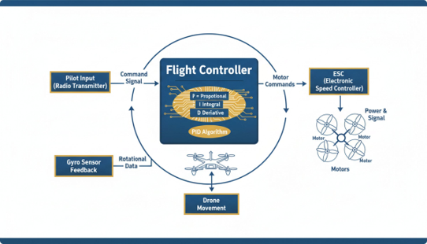

# 4. Yazılım ve Kontrol Mantığı

Bir İHA'nın havada stabil kalabilmesi, sensörlerden gelen verinin
saniyede yüzlerce kez işlenip motorlara komut olarak geri dönmesiyle
mümkün olur. Bu bölümde bu döngünün mantığını, PID algoritmasını ve
görevi üstlenen yazılım bileşenlerini ele alıyoruz.

## Yardımcı Bilgisayar

  

Ana bilgisayar (uçuş kartı) yanında veya onunla birlikte çalışan,
belirli görevleri yerine getiren bir bilgisayar sistemidir. Daha güçlü
bir işlemciye, belleğe ve depolama kapasitesine sahiptir. Robotik,
görüntü işleme, yapay zeka ve derin öğrenme projelerinde sıklıkla
kullanılır.

Kameralar, ekranlar gibi çevre birimleriyle iletişim kurarak ana
bilgisayarın (otopilotun) yükünü hafifletir ve otopilotun daha spesifik
görevlere odaklanmasını sağlar.

## Sensör Verileri ve Temel Kontrol Döngüsü

  

**Sensör Verileri (IMU — Jiroskop, İvmeölçer)**

Kodlama mantığının temeli "şu an hangi açıdayım?" sorusuna yanıt
almaktır. İvmeölçer yerçekimi yönünü (açıyı) ölçerken, jiroskop ise
açısal dönme hızını ölçer.

**Temel Kontrol Döngüsü**

1. Sensörden açıyı oku (Örn: Drone sağa 5 derece yatmış).
2. Kumandadan gelen hedef açıyla karşılaştır.
3. Farkı düzeltmek için ilgili motorların hızını artır/azalt; bu
   döngüyü saniyede yüzlerce kez tekrar et.

Bu akışta uçuş kartı (Flight Controller), pilot komutunu (kumandadan
gelen komut sinyalini) ve jiroskop sensöründen gelen dönme (rotasyon)
verisini birlikte değerlendirerek motor komutlarını üretir; bu
komutlar ESC üzerinden motorlara güç ve sinyal olarak iletilir.

## PID Algoritması

  

**PID (Proportional-Integral-Derivative):** Geri beslemeli sistemleri
istenen hedef değere en hızlı ve kararlı şekilde yönlendirmek için
yaygın olarak kullanılan bir yöntemdir. Drone'un havada titremeden,
rüzgara rağmen stabil kalmasını sağlayan matematiksel algoritmadır.

**Oransal (P — Proportional)**
Hedef ile mevcut değer arasındaki farka dayalı kontrol sinyali
hesaplar. Mevcut hataya bakar; hata ne kadar büyükse motorlara o kadar
sert tepki verir.

**İntegral (I)**
Zamanla biriken hata miktarını hesaplar ve sistem stabilitesini
artırır. Geçmişteki birikmiş hatalara bakar; sürekli dış etkenlerin
sürüklemesini engeller.

**Türev (D — Derivative)**
Hedefe ulaşma hızını düzenler, aşırı salınımları (overshoot) azaltır.
Gelecekteki değişim hızına bakar; hedefe yaklaşırken frenleme yaparak
aşırı sallanmayı (overshoot) önler.

Doğru PID ayarı; istenen tepkiyi sağlar ve kararlılığı artırır.
Arduino veya otopilot yazılımlarında bu 3 parametre ayarlanarak stabil
uçuş elde edilir.

## Otopilot Yazılımları

  

### ArduPilot Nedir?

ArduPilot; çok pervaneli drone'lar (ArduCopter), sabit kanatlı uçaklar
(ArduPlane), kara araçları (Rover), denizaltılar (ArduSub) gibi birçok
araç türünü destekleyen, güvenilir ve açık kaynaklı bir otopilot
yazılımı ailesidir. Stabilizasyon (roll/pitch/yaw), PID kontrol
döngüleri, GPS ile pozisyon tutma, otonom görev uçuşu, arm/disarm
güvenlik kontrolleri ve yer istasyonu haberleşmesi (MAVLink) gibi
uçuş için gereken her şeyi tek bir yazılımda toplar.

ArduPilot'un önemli bir özelliği **HAL (Hardware Abstraction Layer —
Donanım Soyutlama Katmanı)** yapısıdır. Uçuş kodu donanımla doğrudan
değil, bu katman üzerinden konuşur. Böylece aynı ArduCopter kodu, farklı
HAL'lar sayesinde hem Linux çalışan bir bilgisayarda (Linux HAL) hem de
bir RTOS çalışan mikrodenetleyicide (ChibiOS HAL) çalışabilir. T3
Gemstone O1 üzerinde iki farklı yaklaşımın denenebilmesi de bu sayede
mümkündür.

**T3 Gemstone O1 üzerinde ArduPilot (Linux / A53 yaklaşımı)**

T3 Gemstone O1 kartının işlemcisinde aynı çip üzerinde, birbirinden
bağımsız çalışan iki çekirdek ailesi bulunur:

- **Cortex-A53 çekirdekleri:** Güçlü, genel amaçlı çekirdeklerdir.
  Üzerlerinde tam bir Linux (Ubuntu) dağıtımı çalışır; karta SSH ile
  bağlandığınızda girdiğiniz yer burasıdır.
- **Cortex-R5F çekirdeği (MCU domain):** Çok daha küçük, kendi belleği
  ve çalışma mantığı olan, gerçek zamanlı işler için tasarlanmış ayrı
  bir gömülü çekirdektir.

Kartın varsayılan kullanımında ArduCopter, A53 çekirdekleri üzerindeki
Linux'ta sıradan bir program olarak çalışır (Linux HAL). İlk uyguladığımız
ve çalıştığını doğruladığımız yöntem budur. Aşağıdaki rehber, bu
yöntemle kartın imajının yazılmasından başlayıp ArduCopter'ın kaynak
koddan cross-compile (çapraz derleme) ile derlenmesine, karta
aktarılmasına, sensör/PWM/RC ayarlarına ve açılışta otomatik
başlatılmasına kadar tüm süreci adım adım anlatır:

- [T3 Gemstone O1 — ArduPilot Kurulum ve Cross-Compile Rehberi](https://github.com/alitalhq/t3gemstone-ardupilot-docs)

> **Not:** Bu rehberde karta Gem Imager ile **Minimal** (arayüzsüz)
> Ubuntu imajı yazılır; yani A53 tarafında çalışan sistem, masaüstü
> ortamı olmayan hafif bir Linux kurulumudur. Ancak bu, Linux'un tek
> bir çekirdeğe sığacak kadar küçültülmüş özel bir sistem olduğu
> anlamına gelmez; standart bir Ubuntu imajının arayüzsüz sürümüdür.

Bu yöntem çalışır, ancak verimli değildir: Uçuş kontrolü gibi
zamanlamaya çok duyarlı bir iş, genel amaçlı bir işletim sistemi olan
Linux'un üzerinde koşar ve kartın en güçlü çekirdekleri olan A53'leri
meşgul eder.

### ChibiOS Nedir?

ChibiOS, gömülü sistemler için geliştirilmiş, açık kaynaklı, küçük ve
yüksek performanslı bir **Gerçek Zamanlı İşletim Sistemi (RTOS — Real-Time
Operating System)** platformudur. Linux gibi "genel amaçlı" bir işletim
sisteminden farklı olarak, bir görevin tam olarak ne zaman çalışacağını
ve ne kadar sürede biteceğini garanti edebilen, öngörülebilir
zamanlamalı bir yapıya sahiptir. Bu özellik, döngüsünü saniyede
yüzlerce kez aksatmadan çalıştırması gereken bir uçuş kontrolcüsü için
kritik öneme sahiptir.

Piyasadaki uçuş kartlarının (Pixhawk ve benzeri STM32 tabanlı kartlar)
büyük çoğunluğunda ArduPilot, işletim sistemi olarak ChibiOS üzerinde
çalışır. Yani ChibiOS uçuş kartına işletim sistemi olarak yüklenir ve
ArduPilot gibi uygulamaların donanım üzerinde doğru zamanlamayla
çalışmasını sağlar; ArduPilot ise bunun üzerinde otonom uçuşu sağlayan
ana yazılım (firmware) olur.

**T3 Gemstone O1 üzerinde ChibiOS (R5F yaklaşımı)**

İlk yöntemin verimsizliğini gidermek için geliştirilen fikir,
ArduCopter'ı Linux'tan alıp kartın **R5F** çekirdeğine taşımak ve orada
**ChibiOS** üzerinde çalıştırmaktır. Bu yaklaşımda:

- Uçuş kontrolü (ArduCopter) doğrudan R5F çekirdeğinde, ChibiOS
  üzerinde çalışır. Bunun için repoda karta özel bir HAL
  (`AP_HAL_ChibiOS_K3`) yazılmıştır.
- A53 tarafındaki Linux kapanmaz, fakat görevi hafifler: açılışta
  `remoteproc` mekanizmasıyla R5F'e uçuş yazılımını yükler, IMU'nun
  bağlı olduğu SPI yolunu ve PWM çıkışlarını R5F'e bırakır ve R5F ile
  paylaşılan bir bellek bölgesi üzerinden MAVLink trafiğini yer
  istasyonuna (QGroundControl) köprüler.
- R5F, Linux'a göre çok daha düşük gecikmeli ve öngörülebilir
  zamanlama sunar.
- Uçuş kontrolü yükünden kurtulan, daha güçlü A53 çekirdekleri başka
  işlere ayrılabilir. Bu dokümanın yazarının fikri, boşa çıkan A53
  tarafını bir **yapay zeka / yardımcı bilgisayar** (görüntü işleme,
  nesne tanıma, otonom karar verme vb.) olarak kullanmaktır. Bu fikrin
  ayrıntıları ve önerilen proje için
  [07-ornek-yapilandirmalar-ve-eklentiler.md](07-ornek-yapilandirmalar-ve-eklentiler.md)
  bölümündeki "Gelecek Çalışma" başlığına bakınız.

Bu yaklaşımın kurulumunu, derlenmesini, karta yüklenmesini ve bilinen
kısıtlamalarını anlatan repo:

- [T3 Gemstone O1 — ChibiOS Üzerinde ArduCopter](https://github.com/HaruunGNY/T3-Gemstone-O1-Chibos)

> **⚠ Dikkat — deneysel kurulum:** Repodaki bilgilere göre bu kurulum
> gerçek donanımda uçuşla doğrulanmış olsa da henüz deneysel
> durumdadır. Örneğin GPS sürücüsü henüz yazılmadığı için GPS
> gerektiren modlar (Auto, Guided, RTL, PosHold) kullanılamaz; IMU
> okuma hızı 100 Hz ile sınırlı olduğundan `SCHED_LOOP_RATE`
> parametresinin düşürülmesi gerekir ve batarya telemetrisi yoktur.
> Kurulumu denemeden önce reponun "Bilinen Kısıtlamalar" bölümünü
> mutlaka okuyun.

### İki Yaklaşımın Karşılaştırması

| | Linux / A53 yaklaşımı | ChibiOS / R5F yaklaşımı |
|---|---|---|
| ArduCopter'ın çalıştığı çekirdek | Cortex-A53 | Cortex-R5F |
| İşletim sistemi | Linux (Ubuntu, Minimal imaj) | ChibiOS (RTOS) |
| ArduPilot HAL'ı | Linux HAL | `AP_HAL_ChibiOS_K3` (karta özel) |
| Zamanlama | Genel amaçlı, garanti yok | Gerçek zamanlı, öngörülebilir |
| A53 çekirdeklerinin durumu | Uçuş kontrolüyle meşgul | Büyük ölçüde boşta, başka işlere (ör. yapay zeka) ayrılabilir |
| Olgunluk | Çalışan ve doğrulanmış ilk yöntem | Deneysel, bazı özellikler eksik (GPS vb.) |
| Rehber | [alitalhq/t3gemstone-ardupilot-docs](https://github.com/alitalhq/t3gemstone-ardupilot-docs) | [HaruunGNY/T3-Gemstone-O1-Chibos](https://github.com/HaruunGNY/T3-Gemstone-O1-Chibos) |

### Bu Repolar Hakkında Önemli Notlar

- **Yukarıdaki iki repo T3 Vakfı'nın resmi reposu değildir.** İkisi de
  gönüllüler tarafından hazırlanmıştır. T3 Gemstone'un resmi
  dokümantasyonu için [docs.t3gemstone.org](https://docs.t3gemstone.org)
  adresine bakınız.
- **Repolar sırayla hazırlanmıştır.** Önce Linux/A53 yaklaşımını
  anlatan ArduPilot reposu hazırlandı; bu repo yalnızca A53
  çekirdeklerini kullanarak ArduPilot'u kart üzerinde çalıştırıyordu.
  ChibiOS reposu ise bu yöntemin verimsizliğini gidermek ve A53
  çekirdeklerini boşa çıkarmak amacıyla daha sonra geliştirildi.
- **Bu bölümdeki teknik açıklamalar, söz konusu repoların incelenmesiyle
  özetlenmiştir.** Çekirdek mimarisi, yöntemlerin işleyişi ve
  kısıtlamalar konusunda en güncel ve doğru bilgi için doğrudan ilgili
  repolara başvurunuz.
- **A53'ün yapay zeka için kullanılması bu dokümanın yazarının
  fikridir.** ChibiOS reposu R5F'e geçişin gerekçesi olarak gerçek
  zamanlı ve öngörülebilir zamanlamayı öne çıkarır; repolarda A53
  tarafında yapay zeka çalıştıran hazır bir uygulama bulunmamaktadır.

T3'ün kendi resmi ArduPilot sayfası (APT paketiyle kurulum, pin
haritası, servis yönetimi) için:
[docs.t3gemstone.org/tr/projects/ardupilot](https://docs.t3gemstone.org/tr/projects/ardupilot).
T3 Gemstone O1 kartının aviyonik mimarisi için
[06-t3-gemstone-o1-mimarisi.md](06-t3-gemstone-o1-mimarisi.md)
bölümüne bakınız.

---

Devam etmek için [05-parca-secimi-montaj-ve-tasarim-sureci.md](05-parca-secimi-montaj-ve-tasarim-sureci.md).
